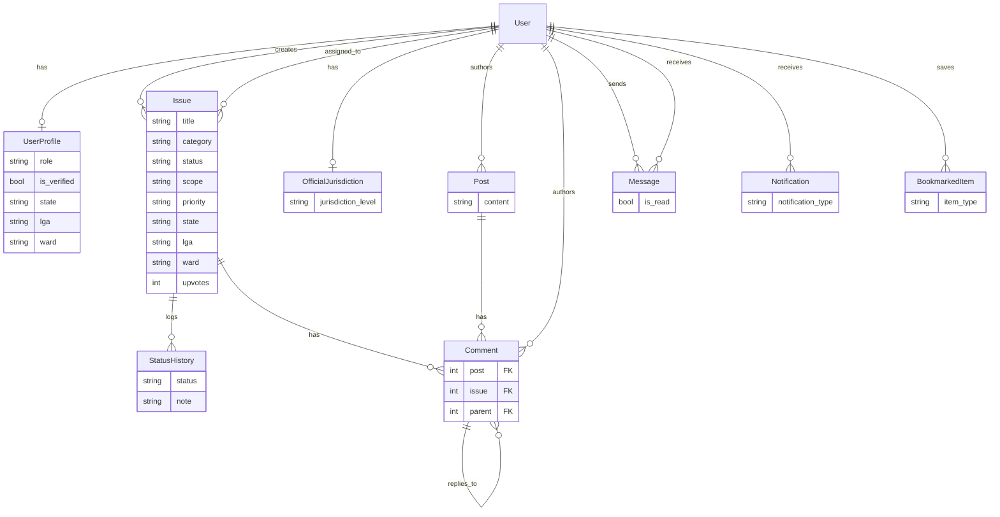

# CivicNet — Citizen Service Delivery Platform

> A civic network for developing democracies. Citizens report local issues, verified officials reply on the record — from ward to federal level. Nothing goes silent.

**Stack:** Django · DRF · PostgreSQL (prod) / SQLite (dev) · React 19 + Vite + Tailwind · Render

## The problem

Service complaints — water, roads, power, health, waste, safety — usually stay informal: word of mouth, chat groups, no public record, no clear owner, no follow-through. CivicNet makes delivery public: one place to file a case with its state / LGA / ward attached, escalation as an issue gains signal, a named verified official accountable for the reply, and a full status-history trail anyone can inspect.

## User roles

| Role | What they do |
|---|---|
| **Citizen** | Sign up, file issues, post to the feed, upvote, comment, message officials, bookmark, track status history |
| **Official** | Verified account tied to a jurisdiction (ward / LGA / state); claim issues, update status with notes, reply on the record, view resolution metrics on the official dashboard |
| **Admin** | Django admin (`/admin/`): users, profiles, issues, jurisdictions, full CRUD |

Roles live in `UserProfile.role` (`citizen` / `official`); verification in `UserProfile.is_verified`; jurisdiction in `OfficialJurisdiction`.

## Key features

1. **Issue reporting + escalation ladder** — category, scope (`local` / `state` / `national`), priority, state / LGA / ward, image URL, upvotes; issues route Ward → LGA → State → Federal as they gain signal.
2. **Verified officials, on-the-record replies** — issue assignment (`assign` / `assign_to_me`), status updates with notes, `StatusHistory` audit log, per-official resolution metrics.
3. **Live Nigeria civic map (landing)** — interactive SVG map with rotating case pins, status legend (open / in progress / resolved), and hover cards showing citizen reports with official replies (`frontend/src/components/landing/NigeriaMap.tsx`).
4. **Social feed + engagement** — posts, likes, threaded comments on posts and issues, bookmarks, explore, notifications.
5. **Messaging + notifications** — direct messages (inbox / sent / read receipts), notification centre (comment, like, message, mention, follow).
6. **Secure token auth** — DRF `TokenAuthentication`, password hashing, Django password validators, CORS/CSRF allow-lists, secure cookies + SSL redirect in production.

## Tech stack

| Layer | Tech |
|---|---|
| Backend | Django 6, DRF, `rest_framework.authtoken`, django-cors-headers, Whitenoise, Gunicorn |
| Database | SQLite locally → PostgreSQL in production via `dj-database-url` + `psycopg2-binary` |
| Frontend | React 19, Vite 7, React Router 7, Tailwind 3, Axios, Framer Motion, Lucide |
| Deploy | `render.yaml` Blueprint: `civicnet-backend` (Python) + `civicnet-frontend` (static, SPA rewrite) |

## Data model

Source of truth: `backend/civic_connect/connectapp/models.py`. Editable source for diagrams: `docs/er-diagram.mmd` (imports into Mermaid Live / draw.io).



## Run it locally

Prerequisites: Python 3.12+, Node 20+.

**Backend:**

```bash
cd backend/civic_connect
python -m venv ../venv && ../venv/Scripts/activate   # Windows
# source ../venv/bin/activate                          # macOS/Linux
pip install -r requirements.txt
cp .env.example .env
python manage.py migrate
python manage.py createsuperuser
python manage.py runserver
# API → http://localhost:8000/api/   Admin → http://localhost:8000/admin/
```

Demo accounts (via `python manage.py populate_sample_data`, password `password123`): `chinedu_citizen`, `jane_official`, `ahmed_resident`. Full endpoint reference: `backend/API_ENDPOINTS.md`.

**Frontend:**

```bash
cd frontend
npm install
cp .env.example .env.development   # set VITE_API_URL, VITE_GOOGLE_CLIENT_ID
npm run dev                        # → http://localhost:5173
```

Environment variables are documented in `backend/civic_connect/.env.example` and `frontend/.env.example` (placeholders only — real secrets stay out of git).

## Deployment

Split deploy from one Blueprint (`render.yaml`): Django API as a Render Web Service, React app as a Render Static Site. Set `DATABASE_URL`, `CORS_ALLOWED_ORIGINS`, `CSRF_TRUSTED_ORIGINS` on the backend and `VITE_API_URL` on the frontend. Step-by-step: `DEPLOYMENT_RENDER.md`. After first deploy, paste the live URLs at the top of this file.

## Project structure

```
.
├── backend/
│   ├── civic_connect/     # Django project: settings, connectapp (models/views/serializers/urls)
│   ├── API_ENDPOINTS.md   # full API reference
│   ├── README.md          # backend-only guide
│   └── seed_demo_data.py  # optional demo seeder (matches current models)
├── frontend/
│   ├── src/
│   │   ├── components/landing/  # Nav, MapHero, NigeriaMap, HowItMoves, ClosingBand, Footer
│   │   ├── pages/               # Landing, Timeline, IssueDetails, OfficialDashboard, …
│   │   └── services/            # apiClient, auth
│   └── public/                  # brand assets, auth hero images
├── docs/
│   ├── er-diagram.mmd
│   └── screenshots/             # add 01-landing / 02-feed / 03-issue / 04-dashboard.png
├── render.yaml
└── README.md
```

## Roadmap

- App screenshots (`docs/screenshots/`) — 1440×900, no personal data
- Google sign-in end-to-end (`POST /api/auth/google/` verifies the ID token, creates the account + profile on first login, returns a DRF token; set `GOOGLE_CLIENT_ID` alongside `VITE_GOOGLE_CLIENT_ID`)
- Backend test coverage (`connectapp/tests.py` is still the Django placeholder)
