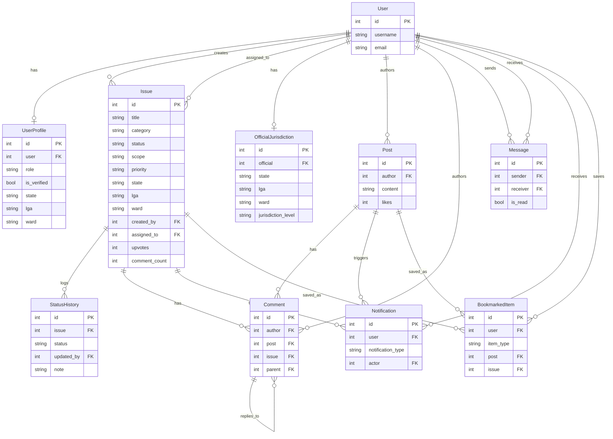

# CivicNet — Citizen Service Delivery Platform

> A civic network for developing democracies. Citizens report local issues (Ward → LGA → State → Federal), verified officials reply on the record. Nothing goes silent.

**Stack:** Django · DRF · PostgreSQL (prod) / SQLite (dev) · React 19 + Vite + Tailwind · Render

- **Repo:** `https://github.com/Donsirmuel/Civic-Pulse`
- **Live:** _add your Render URLs here — see “Repo settings to finish” below_
  - Frontend: `https://civicnet-frontend.onrender.com` ← replace with real URL
  - Backend: `https://civicnet-backend.onrender.com` ← replace with real URL

## 1. The problem

Citizen complaints about water, roads, power, health, waste and safety often stay informal — WhatsApp groups, word of mouth — with no public record, no clear owner, and no follow-through from ward to federal level.

CivicNet makes service delivery public:

- one place to file a case with state / LGA / ward attached,
- escalation as an issue gains signal,
- a named, verified official accountable for the reply,
- a full status-history audit trail citizens can inspect.

## 2. User roles

| Role | What they do |
|---|---|
| **Citizen** | Sign up, file issues, post, upvote, comment, message, bookmark, track status history |
| **Official / Officer** | Verified account with jurisdiction (ward / LGA / state), claim issues (`assign_to_me`), update status with notes, reply on record, view official dashboard + resolution metrics |
| **Admin** | Django admin (`/admin/`), manage users/profiles/issues/jurisdictions, create superuser, full CRUD |

Roles live in `connectapp/models.py → UserProfile.role` (`citizen` / `official`). Verification via `UserProfile.is_verified`. Jurisdiction via `OfficialJurisdiction`.

## 3. Key features

1. **Issue reporting + escalation ladder** — category, scope (`local/state/national`), priority, state/LGA/ward, image URL, upvote/downvote, `Ward → LGA → State → Federal` routing.
2. **Verified officials, on-the-record replies** — `OfficialJurisdiction`, `Issue.assigned_to`, `update_status` with note, `StatusHistory` audit log, official dashboard + `/metrics/` resolution rate.
3. **Live Nigeria civic map (landing)** — interactive SVG map with 14 rotating case pins, status legend (open / in progress / resolved), hover case cards with official replies. See `frontend/src/components/landing/NigeriaMap.tsx`.
4. **Social feed + engagement** — posts, likes, threaded comments (post / issue / parent reply), bookmarks, explore, notifications.
5. **Messaging + notifications** — direct messages (inbox/sent/mark-as-read), notification centre (comment/like/message/mention/follow).
6. **Secure token auth + Google login (frontend)** — DRF `TokenAuthentication`, password hashing via `create_user`/`set_password`, Django password validators, CORS/CSRF lockdown, secure cookies + SSL redirect in prod. Google OAuth button wired in frontend (`@react-oauth/google`); backend `auth/google/` exchange is still WIP — see “Honest gaps”.

## 4. Screenshots

Add 3–4 PNGs to `docs/screenshots/` and they will render here:

```
docs/screenshots/
  01-landing.png    ← landing + Nigeria map
  02-feed.png        ← /feed timeline
  03-issue.png       ← /issue/:id + status history
  04-dashboard.png   ← /dashboard/official
```


Brand assets already in repo: `frontend/public/CivicNet Logo.png`, `CivicNet icon.png`, `Login-hero.jfif`, `Register-hero.jfif`.

> Screenshots missing right now — take them with `npm run dev` + `python manage.py runserver`, 1440×900, no real personal data.

## 5. Tech stack

| Layer | Tech |
|---|---|
| Backend | Django 6.0.2, DRF 3.16.1, `rest_framework.authtoken`, django-cors-headers, Whitenoise, Gunicorn |
| DB | SQLite (dev, `db.sqlite3`) → PostgreSQL in prod via `dj-database-url` + `psycopg2-binary` + `DATABASE_URL` |
| Frontend | React 19, Vite 7, React Router 7, Tailwind 3, Axios, Framer Motion, Lucide, Google OAuth |
| Deploy | `render.yaml` — `civicnet-backend` (python) + `civicnet-frontend` (static, SPA rewrite) |

## 6. Data model (ER diagram)

Source of truth: `backend/civic_connect/connectapp/models.py`. Mermaid source: `docs/er-diagram.mmd` (opens in draw.io / Mermaid live editor — good for data-role interviews).



## 7. Setup

### Prerequisites

- Python 3.12+, Node 20+, Git
- PostgreSQL optional locally (SQLite works out of the box)

### Backend (Django / DRF)

```bash
cd backend/civic_connect
python -m venv ../venv
# Windows:
..\venv\Scripts\activate
# macOS/Linux:
# source ../venv/bin/activate

pip install -r requirements.txt
cp .env.example .env   # or copy backend/.env.example
python manage.py migrate
python manage.py createsuperuser
python manage.py runserver
# API → http://localhost:8000/api/   Admin → http://localhost:8000/admin/
```

Optional demo data:

```bash
python manage.py populate_sample_data
# john_citizen / jane_official / ahmed_resident — password: password123
```

Full endpoint list: `backend/API_ENDPOINTS.md`.

### Frontend (React + Vite)

```bash
cd frontend
npm install
cp .env.example .env.development
# set VITE_API_URL=http://localhost:8000/api
# set VITE_GOOGLE_CLIENT_ID=...
npm run dev     # → http://localhost:5173
npm run build   # production check (tsc -b && vite build)
```

## 8. Environment variables

Backend — see `backend/.env.example` (+ `backend/civic_connect/.env.example`):

```
DEBUG, SECRET_KEY, ALLOWED_HOSTS, DATABASE_URL,
CORS_ALLOWED_ORIGINS, CSRF_TRUSTED_ORIGINS,
SECURE_SSL_REDIRECT, RENDER_EXTERNAL_HOSTNAME
```

Frontend — see `frontend/.env.example`:

```
VITE_API_URL=http://localhost:8000/api
VITE_GOOGLE_CLIENT_ID=...
```

`.env` files are gitignored (root `.gitignore` keeps `!.env.example`).

## 9. Deployment (Render)

`render.yaml` defines two services:

- `civicnet-backend` — `rootDir: backend/civic_connect`, `pip install -r ../requirements.txt && migrate && collectstatic`, `gunicorn civic_connect.wsgi`, `/healthz/`
- `civicnet-frontend` — `rootDir: frontend`, `npm ci && npm run build`, `dist/`, SPA rewrite `/* → /index.html`

Set on Render dashboard: `DATABASE_URL`, `SECRET_KEY` (generate), `CORS_ALLOWED_ORIGINS`, `CSRF_TRUSTED_ORIGINS`, `VITE_API_URL`, `VITE_GOOGLE_CLIENT_ID`.

## 10. Project structure

```
.
├── backend/
│   ├── civic_connect/          # Django project + connectapp (models/views/serializers/urls)
│   ├── API_ENDPOINTS.md
│   ├── README.md               # backend-only guide
│   └── .env.example
├── frontend/
│   ├── src/
│   │   ├── components/landing/ # Nav, MapHero, NigeriaMap, HowItMoves, ClosingBand, Footer
│   │   ├── pages/              # Landing, Timeline, IssueDetails, OfficialDashboard, …
│   │   └── services/           # apiClient, auth
│   ├── public/                 # logos, hero images
│   └── .env.example
├── docs/
│   ├── er-diagram.mmd
│   └── screenshots/
├── render.yaml
└── README.md                   # this file
```

## 11. CV-claim verification (honest)

| CV claim | Repo reality |
|---|---|
| PostgreSQL | ✅ `psycopg2-binary` + `dj-database-url` + `DATABASE_URL` in `settings.py`, `render.yaml`. Local dev uses SQLite — correct pattern, say “PostgreSQL in production”. |
| Draw.io / ERD | ⚠️ No `.drawio` file. Fixed by adding `docs/er-diagram.mmd` + Mermaid block above — import the `.mmd` into draw.io to export the screenshot recruiters expect. |
| Secure auth | ✅ Token auth, `set_password` hashing, 4 Django password validators, `IsAuthenticatedOrReadOnly` + `AllowRegistration` + `IsAssignedOfficialOrReadOnly`, CORS/CSRF allow-lists, `SESSION/CSRF_COOKIE_SECURE` + `SECURE_SSL_REDIRECT` in prod. |
| Google auth | ⚠️ Frontend sends `id_token` to `auth/google/` (`frontend/src/services/auth.ts`) but backend has **no** `auth/google/` view yet — mark as “frontend-wired, backend WIP” in interviews. |

## 12. Repo settings to finish (2 min, GitHub web UI)

1. **About → description:** `CivicNet — citizens report local issues, verified officials reply on the record (Django + DRF + PostgreSQL + React).`
2. **About → website:** paste live Render frontend URL.
3. **About → topics:** `django` `djangorestframework` `postgresql` `react` `vite` `tailwindcss` `e-governance` `civic-tech` `nigeria`
4. Upload `docs/screenshots/*.png` so the section above renders.
5. (Optional) Import `docs/er-diagram.mmd` into draw.io → export PNG → `docs/er-diagram.png`.
